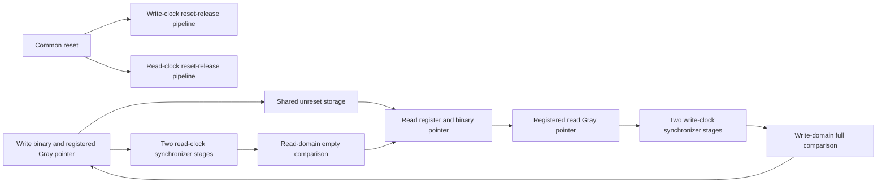

# Dual-clock FIFO architecture and contract

Milestone 2 — 2026-11-05. This design is separate from `sync_fifo.sv`.

## Interface and hardware

| Signal | Domain | Meaning |
|---|---|---|
| wr_clk, rd_clk | Separate clocks | Independent rising-edge write/read clocks |
| rst_n | Both | Common asynchronous flush reset |
| wr_ready, rd_ready | Respective local clock | Local reset release completed; not a data transfer handshake |
| wr_en, wr_data | wr_clk | Request and payload; stable before its rising edge |
| rd_en | rd_clk | Read request; stable before its rising edge |
| wr_full | wr_clk | Local conservative full flag |
| rd_empty | rd_clk | Local conservative empty flag |
| rd_data | rd_clk | Registered result of last accepted read, zero after reset |

Accepted write = wr_ready && wr_en && !wr_full at a write rising edge.
Accepted read = rd_ready && rd_en && !rd_empty at a read rising edge.
Rejected operations do not advance their local pointers. rd_data holds when
no read is accepted. Consumers must use the appropriate ready output after
reset; wr_full=0 during reset does not mean writes can be accepted.

The array has a write port clocked by wr_clk and a registered read in rd_clk.
Data bits do not pass through individual synchronizer chains. Pointer transfer
ensures the reader cannot consume an entry before its write is published,
or the writer reuse an unread entry. Physical storage mapping and data-path
timing still need validation; a generic behavioral array is not a qualified
ASIC memory macro. No reset clears storage cells.



The architecture follows the synchronized-pointer approach in Cummings'
FIFO Style 1 paper. This implementation adds local reset-release pipelines
and retains the registered-read contract rather than adopting a combinational
first-word output. [Primary paper](https://www.researchgate.net/profile/Clifford-Cummings/publication/252160343_Simulation_and_Synthesis_Techniques_for_Asynchronous_FIFO_Design/links/54bfe9720cf28eae4a66418a/Simulation-and-Synthesis-Techniques-for-Asynchronous-FIFO-Design.pdf).

## Derivation of the pointer equations

Let DEPTH = D = 2^A, with A >= 1. A bits address the storage slots. Each local
binary pointer has P = A+1 bits and advances modulo 2D. Its low A bits index
memory; its extra bit distinguishes the two laps of the circular buffer.
A pointer returns to the same full binary value only after 2D accepted operations.

For a local binary value b, define reflected Gray encoding G(b)=b XOR (b>>1).
Two adjacent binary counts, including the 2D-1 to 0 wrap, encode to Gray
values that differ by one bit. The source Gray value is registered to avoid
combinational encoding glitches reaching the CDC path.

```text
w_next  = w_binary + accepted_write     (modulo 2D)
r_next  = r_binary + accepted_read      (modulo 2D)
wg_next = w_next XOR (w_next >> 1)
rg_next = r_next XOR (r_next >> 1)
empty_next = (rg_next == synchronized_wg)
full_next  = (wg_next == (synchronized_rg XOR full_mask))
full_mask  = 3 << (A-1), stored in P bits
```

Empty means equal complete pointers, so a comparison of their Gray encodings
also detects equality. Full means equal low address bits and opposite extra
binary bits: w = r XOR 2^A. In Gray encoding g_A=b_A and
g_(A-1)=b_A XOR b_(A-1); flipping only b_A therefore flips the top **two** Gray
bits while every lower Gray bit stays unchanged. That derives full_mask.
For depth 2, A=1 and the mask is binary 11: no negative or empty part-select
is needed. The RTL uses a sized shift to cover this smallest case.

Flags compare next local pointers and are registered in their local domain.
This asserts full on the write that consumes the final known free slot and
empty on the read that consumes the final known published item. Acceptance
at the edge uses the old local flag, avoiding a combinational feedback loop.

## Delayed knowledge and simultaneous requests

Synchronizers carry delayed remote progress. The write domain may still
report full after a read frees space, and the read domain may still report
empty after a write provides data. These are conservative stalls. The local
flag is not an exact global occupancy indicator; do not subtract unrelated
binary pointers directly or expect full/empty to behave like the synchronous
baseline at every instant. Both flags can be asserted temporarily during
some traffic histories without violating the contract.

Each remote update passes through two destination-clock flip-flops, followed
by a registered comparison. In ideal RTL, a remote update influences a flag
on the third capturing destination rising edge; the first capture depends
on clock phase. Another destination edge is needed to accept a request using
that newly cleared flag. Metastability can add latency; the ideal simulation
bound is not a physical hard bound. A stopped clock prevents progress in its
domain but must not corrupt data in the other domain.

At coincident clock edges each side independently uses its pre-edge local
flag. There is no cross-domain same-edge bypass or replacement guarantee.
This is the justified interface change from a shared occupancy counter.

## Reset strategy and operating assumptions

1. Assert common rst_n low to flush **both** domains. Meet minimum reset pulse
   width for the target cells, including when clocks stop. Reset pointers,
   pointer synchronizers, local flags, output register, and release pipelines.
2. On external release, each two-flop pipeline shifts in ones using its own
   clock. Its second stage becomes its local active-low reset and ready output.
3. Local state remains reset while ready is low. After two clock edges ready
   rises; local state can accept its first request at the following local edge.
   One clock can resume earlier than the other; common assertion already
   established both pointer baselines.

Requests during reset are ignored. No unilateral domain reset is supported:
resetting only one pointer while the other domain retains outstanding data
can destroy the meaning of pointer distance and expose stale storage.
The external reset is a flush operation, not a lossless pause or handshake.
`ASYNC_REG` attributes identify pointer and reset synchronizers for downstream
tools; attributes alone do not establish placement, MTBF, or timing closure.

## Metastability and timing constraints

Only first synchronizer stages sample asynchronous registered Gray buses.
The first stage can become metastable; the second gives resolution time and
reduces the probability of propagating an unresolved value. There is no
absolute physical guarantee. A quantitative MTBF estimate requires actual
cell parameters, clock rates, data-toggle rates, and placed routing delays.
No such estimate or physical CDC signoff was performed here.

A destination may skip source Gray values when the source is faster. Thus
multiple bits can differ between successive **destination** observations;
asserting one-bit change on the synchronized bus would be invalid. The
one-bit property applies to consecutive source Gray states (outside reset).

Physical implementation must preserve that source sequence at the first
receiving stage. Constrain the registered Gray source-to-first-stage paths
in both directions with a datapath maximum delay and bus-skew budget smaller
than the minimum source period across supported modes, with margin. A
conservative common budget uses the faster of the two minimum clock periods.
Limit skew so transitions from successive source increments cannot overlap
as unrelated-bit arrivals. Also keep each first-to-second-stage local path
short to maximize metastability resolution time.

An integration flow must identify actual synthesized source Q and first-stage
D pins (wr_gray to wr_gray_meta; rd_gray to rd_gray_meta), retain the
synchronizers, define both clocks, and verify path coverage in timing reports.
Asynchronous clock groups or broad false paths must not override and silently
disable the intended Gray max-delay/skew checks. Check tool-specific exception
precedence and use appropriate targeted constraints. Reset recovery/removal
and release-tree skew need review too. No executable SDC is supplied because
there is no selected target library, clock budget, or verified netlist naming.
A made-up clock constraint would not constitute physical validation.

## SystemVerilog and synthesis discussion

Binary counters, Gray registers, two-stage synchronizers, flags, and read data
use `always_ff` with nonblocking assignments. Shift/XOR conversion and sized
comparisons are combinational logic. All arithmetic widths are explicit; only
legal power-of-two parameters are supported. The storage write process has
no reset; local write acceptance gates it off during reset. A signal-scoped
SYNCASYNCNET waiver records this intentional local reset use. The assertion
parameter guards are simulation-only under translate-off comments.

These constructs describe synthesizable circuits, but dual-clock memory
mapping and reset behavior must still be assessed by synthesis in Milestone 5.
Supporting simulation is not a measured timing/area/power result.

## Interview questions

- Why does full invert two Gray bits rather than only the MSB? Derive the top two Gray equations from binary.
- Why add a pointer bit? Equal addresses occur at both empty and one complete lap of occupancy.
- Why register Gray values? Combinational XOR networks can glitch as binary counter bits settle.
- Why can flags be pessimistic? Remote progress is delayed; stale read progress reduces apparent free space, and stale write progress reduces apparent available data.
- Why not synchronize each data bit? Independent sampling cannot guarantee a coherent changing word. The FIFO instead transfers ownership of stable storage through pointer publication.
- Does a two-flop chain eliminate metastability? It reduces risk under physical assumptions; neither simulation nor RTL formal proof establishes analog absence.
- Can a stopped read clock be tolerated? The write side can use remaining capacity and then stalls; restart must preserve ordering and eventually release full.
- Why disallow one-sided reset? Outstanding pointer distance and data ownership would lose their shared baseline.
