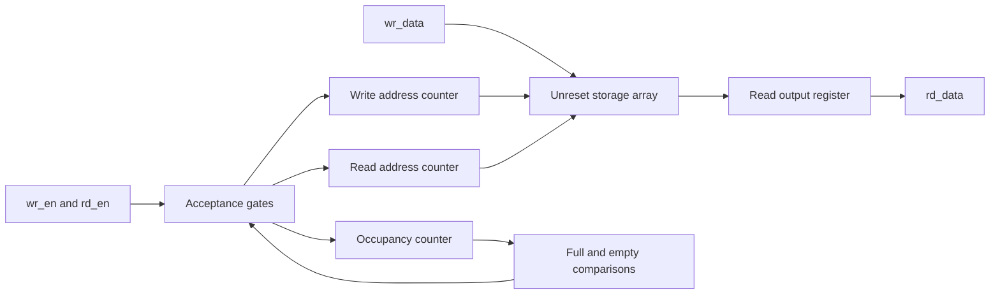

# EP01 — Design and Verification of a Parameterized Dual-Clock Asynchronous FIFO

Academic engineering report — updated 2026-11-05.

The original eighteen sections below retain the Milestone 1 results as a
historical baseline. The appended updates record asynchronous architecture, cocotb evidence,
and Milestone 4 formal results; older statements about pending work refer
to the historical milestone in which they appear.

**Provenance:** the original project was unavailable. The user explicitly
instructed “start fresh.” All sources here are a new implementation; no claims
are made about reviewing or repairing the missing original. The long-term
project is an asynchronous FIFO, but this milestone implements a synchronous
reference design only. No hardware or paid EDA software is required.

## 1. Abstract

A parameterized synchronous FIFO was implemented in SystemVerilog as the
verified baseline for a future dual-clock FIFO portfolio project. Four
width/depth configurations passed Verilator lint and Icarus simulation using
three deterministic seeds each. The regression executed 120,000 randomized
traffic steps plus directed boundary, wraparound, and reset checks. Results
are simulation evidence, not exhaustive correctness proofs.

## 2. Introduction

The portfolio targets an ASIC RTL/design-verification internship from May
through December 2027. This first milestone establishes a precise interface
contract, synthesizable RTL style, independent checking, and reproducible
execution before introducing clock-domain crossing (CDC).

## 3. Industry motivation

FIFOs decouple producers and consumers that burst at different rates. A
single-clock baseline teaches occupancy accounting and interface latency.
Separate clock domains add synchronization delay, conservative flags, and
physical timing constraints; that work is intentionally deferred until the
baseline is stable.

## 4. Functional requirements

Parameters are DATA_WIDTH >= 1 and DEPTH = 2^A >= 2. Depth one is explicitly
unsupported in this baseline. All inputs except reset belong to clk. Signals
are wr_en, rd_en, wr_data, registered rd_data, full, empty, and active-low
rst_n. Requests are sampled at rising edges. Flags describe current occupancy.

| State before edge | wr_en | rd_en | Accepted operation | Occupancy change |
|---|---|---|---|---|
| Empty | 1 | 1 | Write only | +1 |
| Full | 1 | 1 | Read only | -1 |
| Interior | 1 | 1 | Read and write | 0 |
| Any | 0 | 0 | None | 0 |
| Full | 1 | 0 | None | 0 |
| Empty | 0 | 1 | None | 0 |

An accepted read updates rd_data after that edge; all other operations hold
its previous value. Reset sets rd_data to zero and empties the logical FIFO.
It discards queued words and resets pointers and occupancy, but does not
clear memory. During reset no memory write occurs even with wr_en asserted.
Reset assertion is asynchronous. Physical integration must release reset
synchronously to clk and meet recovery/removal timing. The bench releases
on a falling edge for deterministic simulation; it does not model analog
reset behavior or supply a production reset synchronizer.

## 5. Theoretical background

Two address counters identify the oldest unread word and next write slot.
The counters wrap naturally when stored in A bits for depth 2^A. Equal
addresses alone cannot distinguish full from empty; a separate occupancy
counter disambiguates these states in this single-clock implementation.
The future asynchronous design requires a different mechanism because a
shared occupancy counter cannot be safely updated from unrelated clocks.

## 6. Mathematical equations

Let W be data width, D be depth, A = log2(D), and C be occupancy.
The occupancy register requires A+1 bits to represent every value 0 through D.

```text
write_accept = wr_en AND (C < D)
read_accept  = rd_en AND (C > 0)
C_next       = C + write_accept - read_accept
wr_ptr_next  = (wr_ptr + write_accept) mod D
rd_ptr_next  = (rd_ptr + read_accept) mod D
full         = (C == D)
empty        = (C == 0)
rd_data_next = memory[rd_ptr] if read_accept else rd_data
```

All acceptance decisions use pre-edge state. Consequently a full simultaneous
request cannot replace the word being removed, and an empty simultaneous
request cannot bypass memory. The invariant 0 <= C <= D follows inductively
from these acceptance rules, assuming valid reset and correct arithmetic.
This is design reasoning, not a machine-checked formal proof.

## 7. Hardware architecture



The array describes D words of W bits. The write port is clocked and the
read result is registered. An actual ASIC implementation may use registers
or an appropriate memory macro; inference and mapping have not been measured.
At interior occupancy both ports may operate together on distinct addresses.
At equal-address full/empty states the acceptance rules prevent a simultaneous
accepted read and write, so no same-address collision mode is required by
valid operation.

## 8. RTL implementation

`rtl/sync_fifo.sv` uses `always_ff` and nonblocking assignments for state.
A separate clocked write block omits memory reset. The control block resets
pointers, occupancy, and output asynchronously. A case over the two accepted
operations selects increment, decrement, or hold; this prevents conflicting
updates to the occupancy register.

Fixed-width pointer addition implements modulo-D arithmetic. `$clog2` and
explicit constant size casts are elaboration-time operations. Comparisons
and acceptance gates describe combinational logic. These are synthesizable
constructs; synthesis execution is deferred to Milestone 5. Simulation-only
parameter guards use `$fatal` inside synthesis translate-off comments.

One narrowly scoped Verilator SYNCASYNCNET waiver is applied at rst_n's
port declaration: reset asynchronously clears control state and is sampled
to inhibit clocked memory writes. No global warning suppression is used.
This intentional usage and its release-timing requirement must be reviewed
again during synthesis and physical integration. See the initial warning in
`logs/development/initial_lint.log` and [Verilator's warning documentation](https://verilator.org/guide/latest/warnings.html).

## 9. Verification methodology

`tb/tb_sync_fifo.sv` maintains an abstract shift-and-append queue and an
expected read-output value. It never reads DUT pointers, memory, or count.
Requests are driven on falling edges; outputs are checked before the next
rising edge to detect unintended combinational changes and after a 1 ns
settling interval to observe nonblocking updates. Four-state comparisons
also catch unknown flags or output values. The clock period is 10 ns; no
hardware timing claim is implied.

The checker makes acceptance decisions from its own occupancy before the
edge. It compares full, empty, and registered read data after every step.
A watchdog and fatal diagnostics report seed, cycle, occupancy, and expected
versus actual values. PRNG xorshift32 uses explicit 32-bit operations and two
state advances per randomized step, avoiding simulator-specific random streams.
Periodic resets discard the reference queue exactly as the contract requires.

`python3 scripts/regress.py` executes tools, captures combined stdout/stderr,
records command lines and exit statuses, checks PASS markers, and saves
source SHA-256 hashes in `logs/milestone1/summary.json`. Expected-failure
parameter tests require both a nonzero exit and a parameter-guard diagnostic.
Icarus is invoked with `-g2012` to enable SystemVerilog; see its
[official command-line reference](https://steveicarus.github.io/iverilog/usage/command_line_flags.html).

## 10. Directed test results

All twelve runs executed and passed these checks:

| Check | Evidence and expected behavior |
|---|---|
| Reset | Immediate zero output, empty asserted, full deasserted; requests asserted during reset |
| Underflow | Empty read rejected; previous output held |
| Empty simultaneous requests | Only write accepted; no output bypass |
| Interior simultaneous requests | Oldest data returned, new data appended, occupancy unchanged |
| Overflow | Full write rejected; drain verifies retained word ordering |
| Full simultaneous requests | Only read accepted, leaving one free slot |
| Wraparound | At least three additional complete fill/drain rotations |
| Registered output | Stable between edges and during idle/rejected operations |
| Reset recovery | Reset from occupied and full states followed by fresh traffic; stale words never returned as valid data |

Coverage counters are checked before PASS, including full/empty/interior
simultaneous operations. Memory non-clearing is established by RTL inspection;
external functional tests cannot prove that storage cells lack reset circuitry.
Three separate negative runs correctly rejected depth 1, depth 3, and width 0
at simulation time zero with exit status 1. These are expected rejections.

## 11. Randomized regression results

Tool environment: WSL2 Ubuntu 24.04.4 LTS; Verilator 5.020 (Debian 5.020-1);
Icarus Verilog and vvp 12.0 (stable). Actual command: `python3 scripts/regress.py`.
Four parameter configurations x seeds 1, 42, 2027 x 10,000 randomized steps
= 120,000 randomized steps. Directed and final drain steps are additional.

| Width | Depth | Seed | Checked steps | Writes | Reads | Both at full | Both at empty | Both interior | Resets |
|---|---|---|---|---|---|---|---|---|---|
| 16 | 16 | 1 | 10155 | 5014 | 4904 | 67 | 76 | 2378 | 13 |
| 16 | 16 | 2027 | 10156 | 4941 | 4843 | 78 | 116 | 2333 | 13 |
| 16 | 16 | 42 | 10160 | 4994 | 4900 | 66 | 99 | 2374 | 13 |
| 1 | 2 | 1 | 10029 | 3791 | 3782 | 648 | 611 | 1262 | 13 |
| 1 | 2 | 2027 | 10029 | 3782 | 3767 | 611 | 607 | 1309 | 13 |
| 1 | 2 | 42 | 10030 | 3793 | 3779 | 633 | 632 | 1274 | 13 |
| 32 | 256 | 1 | 12315 | 6351 | 5906 | 1 | 61 | 2459 | 13 |
| 32 | 256 | 2027 | 12316 | 6299 | 5819 | 1 | 104 | 2422 | 13 |
| 32 | 256 | 42 | 12320 | 6306 | 5892 | 1 | 79 | 2459 | 13 |
| 8 | 4 | 1 | 10047 | 4432 | 4414 | 331 | 294 | 1896 | 13 |
| 8 | 4 | 2027 | 10048 | 4407 | 4380 | 297 | 310 | 1920 | 13 |
| 8 | 4 | 42 | 10048 | 4452 | 4427 | 308 | 313 | 1918 | 13 |

Total checked traffic steps: 127653. Accepted writes: 58562.
Accepted reads: 56813. Writes and reads differ because reset discards
pending data. Each run asserts reset 13 times: initial, occupied, full, and
ten periodic resets. Coverage counts include directed and randomized phases;
they are simple counters, not formal or vendor functional-coverage metrics.

All 29 recorded commands met expectations: three version queries, four RTL
lint invocations, four testbench compiles, twelve positive simulations, three
negative-case compiles, and three expected-failure simulations. RTL lint and
positive compilation logs contain no diagnostics after the scoped reset waiver.

The documented Bash wrapper also passed a separate 21-command smoke run
with one random step and seed 1 per configuration; see
`logs/entrypoint_smoke/`. This is separate from the numerical matrix above.
Source hashes were checked against the full regression after documentation.

## 12. Assertion and formal results

Simulation procedural checks passed for flags, output data, reset response,
output holding, and required coverage. No concurrent SVA, SymbiYosys harness,
SMT proof, clock model, proof depth, or exhaustive safety result exists yet.
Those items belong to Milestone 4. Pointer advancement and memory write
enables were checked indirectly through behavior, not separately proven.
RTL simulation/formal reasoning cannot establish physical metastability absence.

## 13. Synthesis results

Not executed. Flip-flop counts, mapped logic, memory realization, area, timing,
and power are unmeasured. Theoretical storage is D*W bits plus 2*A pointer
bits, A+1 occupancy bits, and W output bits; this is an architectural inventory,
not a synthesized cell count. No ASIC PPA claims are made.

## 14. Bugs and debugging

No original implementation was available for defect comparison. The first
new-design lint run stopped on the intentional reset SYNCASYNCNET warning.
Its root cause was the necessary memory write inhibit alongside asynchronous
control reset. The corrective action was an explained, signal-scoped waiver,
not a contract change. The final matrix passed. No functional mismatch was
observed in the executed simulations; this does not establish bug absence.

The first ad hoc lint shell wrapper accidentally masked the lint exit code
while preserving its error output. The final Python runner reads subprocess
exit codes directly and verifies every result. The initial lint is recorded
as failed, regardless of that wrapper's exit status.

## 15. Design trade-offs and interview discussion

- **Why use A+1 occupancy bits?** D is a valid full count and cannot fit in A bits. Pointers use A bits because addresses stop at D-1.
- **Why reject a write at full during a simultaneous read?** Pre-edge acceptance keeps gating simple and preserves the specified interface. Permitting replacement could improve throughput at full but would change the contract and collision considerations.
- **Why register the read output?** It provides a defined clocked interface and requires the consumer to use the value after an accepted edge. It differs from a first-word-fall-through FIFO.
- **Why omit memory reset?** Logical validity is tracked by control state; clearing storage is unnecessary for functional recovery and can hinder memory inference. Reset does not securely erase data.
- **Why nonblocking assignments?** All state updates use old state at the sampling edge, matching flip-flop behavior and avoiding procedural ordering dependencies between registers.
- **Why power-of-two depth?** Fixed-width address overflow naturally wraps. Arbitrary depths require an explicit terminal-count wrap comparator.
- **Why can this occupancy counter not serve a dual-clock FIFO?** Updates from unrelated clocks cannot safely share one state register. Separate domain pointers and synchronized Gray representations are needed in the next milestone.

## 16. Limitations

Finite simulation covers four configurations and three seeds, not all legal
parameter values or traffic sequences. Only Icarus executed the testbench;
Verilator was used for RTL lint. Clock/reset analog behavior, physical memory
mapping, CDC, formal proof, and synthesis remain unverified. No cocotb
verification environment exists yet. The reset waiver is intentional and
requires integration review. Very large custom runs must respect the fixed
100 ms simulation watchdog. No GitHub Actions execution has occurred.

## 17. Conclusions

Milestone 1 is complete for the new synchronous baseline under the documented
contract and executed regression matrix. The next milestone is a dual-clock
architecture: separate binary and Gray pointers, two-flop pointer synchronizers,
local flag logic, coordinated reset strategy, and documented Gray-bus timing
requirements. That architecture is not implemented in this milestone.

## 18. References

1. User-provided EP01 requirements and subsequent authorization to start fresh.
2. [Verilator official errors and warnings](https://verilator.org/guide/latest/warnings.html), consulted 2026-11-04; installed version captured separately in logs.
3. [Icarus Verilog official compiler flags](https://steveicarus.github.io/iverilog/usage/command_line_flags.html), consulted 2026-11-04; installed version captured separately in logs.
4. Project RTL, testbench, execution logs, and machine-readable summary, which are the primary evidence for the numerical results in this report.


# Milestones 2 and 3 update — 2026-11-05

## Abstract, motivation, and scope

The synchronous baseline is retained. A separate dual-clock FIFO and an
independent cocotb environment have been added. The new work transfers
ownership of queued data between independently clocked producer and consumer
interfaces, addressing a practical ASIC CDC use case. The source files are
`rtl/async_fifo.sv`, `tb/cocotb/test_async_fifo.py`,
`tb/cocotb/Makefile`, `scripts/regress_async.py`, and `requirements.txt`.

## Functional requirements and theoretical derivation

The asynchronous interface uses wr_full and rd_empty in their respective
domains, with wr_ready and rd_ready indicating local reset completion.
The flags intentionally reflect delayed remote progress and may conservatively
stall requests. This change was explained before implementation; an exact
shared occupancy flag cannot be safely maintained by unrelated clocks.
Registered read output, rejection protection, power-of-two depth, and unreset
memory remain part of the contract. Common reset flushes both domains;
one-sided reset is unsupported.

The complete equations, extra-bit derivation, block diagram, circuit teaching
notes, and interview questions are in [the architecture document](async_architecture.md).
For D=2^A entries, binary and Gray pointers are A+1 bits. The local binary
pointer supplies the low A address bits. Converting b to b XOR (b>>1) supplies
a registered Gray value for remote synchronization. Empty compares complete
equal Gray values; full compares against a remote Gray value with its top
two bits inverted. This follows by flipping only binary bit A and expanding
the two leading Gray equations. RTL uses next-pointer comparisons so local
flag assertions coincide with exhausting known space/data.

## Hardware architecture and RTL

Each domain has binary and registered Gray pointer state, a two-stage pipeline
for the remote Gray bus, and a registered flag. Read data is registered on
an accepted rd_clk edge. Storage writes occur only on accepted wr_clk edges
and storage has no reset branch. Two separate reset-release pipelines derive
local resets from common rst_n. External assertion is asynchronous; each
release is clocked locally and wr_ready/rd_ready gate transactions.

`always_ff`, nonblocking assignments, sized increments, XOR/shift logic,
and fixed-width comparisons describe the intended registers and logic.
Synthesis has not yet assessed dual-clock memory mapping. The parameter
guards are simulation-only. A signal-scoped SYNCASYNCNET waiver on wr_rst_n
records the intentional reset use for both asynchronous control initialization
and write inhibition. ASYNC_REG attributes identify synchronizer stages but
do not substitute for target-cell selection or physical constraints.

## Verification methodology and independence

The cocotb bench maintains a Python deque of accepted data words and an
expected registered read value. It observes only public interface signals;
it never reads pointers, Gray codes, memory, reset pipelines, or synchronizers.
The acceptance protocol uses the DUT's public local flag and ready output,
as a real producer/consumer would. Independently, the queue checks that no
accepted read occurs without prior data and no accepted write exceeds depth.
Bounded fill/drain progress checks detect a flag that wrongly stalls forever.

The scoreboard intentionally does not demand flags equal instantaneous queue
occupancy: conservative latency is legal. At every scheduled rising edge,
acceptance is sampled before updating clocks. Coincident edges are handled
in one scheduler, popping the old queue before appending a same-time write.
Data is checked 1 ps after each rising/falling clock event, including rejected
operations and idle periods. Inputs change at their respective falling edges.
Reset flushes expected data and the reference queue.

A locally seeded Python Random instance drives four traffic mixes: 90%/10%,
10%/90%, 65%/65%, and 50%/50% write/read request probabilities. Every case
includes directed tests. Failure diagnostics include seed, time in ps,
occupancy, and a bounded recent-event history. The runner records the full
clock/phase/parameter environment needed to reproduce each case. JUnit XML
and coverage JSON are both required in addition to successful exit statuses.
A 180-second host timeout and 50 ms simulation watchdog bound individual runs.

## Directed test results

The smoke case passed fill, drain, full/empty rejection, at least four complete
pointer rotations, registered data/output holding, reset from full and partial
occupancy, reset release while the read clock is stopped, and a stopped read
clock during ordinary filling followed by ordered recovery. Each case checks
full occupancy was reached, rejected read/write attempts occurred, minimum
accepted transfer counts were met, and four resets occurred.

The initial smoke run used width 8, depth 16, write/read periods 10/14 ns,
phase offset 0, seed 1, and 400 random scheduler events. It passed all 13
runner commands, including three lint configurations and expected-failure
parameter tests. Raw evidence is in `logs/async_smoke/`.

## Randomized regression results

**Passed:** all 37 cocotb simulations; all 49 recorded commands met their
expected outcomes. The 36 matrix cases each ran 6,000 random scheduler events;
the separate longer case ran 100,000. Total random events: **316,000**.
All simulations also executed their directed tests.

| Width/depth | Write/read periods (ns) | Read startup offset (ns) | Seeds | Random events per case | Passed |
|---|---|---|---|---|---|
| 1/2 | 10/10 | 0 | 1,42,2027 | 6000 | 3/3 |
| 1/2 | 10/10 | 2.5 | 1,42,2027 | 6000 | 3/3 |
| 1/2 | 10/14 | 0 | 1,42,2027 | 6000 | 3/3 |
| 1/2 | 14/10 | 3 | 1,42,2027 | 6000 | 3/3 |
| 8/16 | 10/10 | 0 | 1,42,2027 | 6000 | 3/3 |
| 8/16 | 10/10 | 2.5 | 1,42,2027 | 6000 | 3/3 |
| 8/16 | 10/14 | 0 | 1,42,2027 | 6000 | 3/3 |
| 8/16 | 10/14 | 1 | 2027 | 100000 | 1/1 |
| 8/16 | 14/10 | 3 | 1,42,2027 | 6000 | 3/3 |
| 32/64 | 10/10 | 0 | 1,42,2027 | 6000 | 3/3 |
| 32/64 | 10/10 | 2.5 | 1,42,2027 | 6000 | 3/3 |
| 32/64 | 10/14 | 0 | 1,42,2027 | 6000 | 3/3 |
| 32/64 | 14/10 | 3 | 1,42,2027 | 6000 | 3/3 |

The read startup offset is added to the read clock's first half-period;
clock edges subsequently follow their configured periods. No analog jitter
is modeled. Seeds are recorded per case, including Python RNG state origins.

Across this full run: 379,055 scheduled events,
121,216 write rising edges, 110,067 read
rising edges, 33,614 accepted writes, and 32,101
accepted reads. There were 28,973 rejected write requests
and 24,994 rejected read requests while locally ready.
Coincident rising edges: 35,128; simultaneous accepted
transfers at those edges: 3,252. Every case reached
its configured depth and performed four resets (148 resets total).

Three Verilator --Wall RTL lint configurations passed with the documented
local reset waiver and no emitted diagnostics. Invalid depth 1, depth 3, and
width 0 simulations exited 1 as expected. The other 46 command statuses were 0.
Tool evidence: Verilator 5.020; Icarus 12.0; cocotb 2.0.1;
runner Python --version reports 3.12.3 (the cocotb embedded-Python banner
reports 3.12.4; both actual banners are retained rather than conflated).

Evidence: `logs/async_regression/summary.json`, 37 per-case JUnit files,
37 coverage JSON files, and individual command logs. The complete source
hashes were rechecked after the run and matched. No functional mismatch
was observed in this executed regression.


A scheduler event can contain a rising edge, a falling edge, or coincident
edges; random event counts must not be called clock-cycle counts. Coverage
records include accepted/rejected operations, write/read edges, coincident
rising edges, simultaneous accepted transfers, peak occupancy, and resets.
Writes can exceed reads because reset discards pending words.

## Assertion and formal results

Procedural simulation assertions check capacity, ordering, output holding,
reset response, progress, and directed coverage. Gray-code transition,
internal pointer-update, and local flag invariants have not been formally
proven. No concurrent SVA, SMT solver result, proof depth, or formal clock
model is claimed. Milestone 4 remains pending.

## Synthesis results

Not executed. Architectural state now includes binary and Gray pointers,
remote-pointer synchronizer pipelines, reset-release pipelines, flag registers,
output data, and unreset storage. No measured flip-flop or logic count,
SRAM mapping, timing, power, or area result is available. Milestone 5 is pending.

## Debugging, decisions, and trade-offs

An early launch failed because pip was still installing cocotb and
cocotb-config was not yet present. No RTL simulation ran in that attempt.
Its log is retained in `logs/async_initial/`. The runner's failure-summary
writer also initially assumed cocotb metadata existed; it now records
“not installed” when dependency metadata is absent. Installation completed
successfully before the passing smoke run. Source changes preceded the full
regression. No functional RTL mismatch was observed in the smoke run.

The principal trade-offs are conservative flag latency for safe ownership,
extra binary/Gray state for simple local arithmetic and robust CDC encoding,
registered output latency for a clear interface, and coordinated flush reset
instead of a more complex one-sided-reset recovery protocol. The architecture
document explains the circuits, synthesizability, tests, and interview topics.

## Limitations and physical assumptions

RTL simulation does not model metastability. Two-flop pipelines reduce
physical propagation risk; they do not prove its absence. The Gray source bus
must be registered and source-to-first-stage delay/skew constrained against
the minimum source clock period with margin. A destination may skip Gray
values, so its consecutive samples can differ in several bits. A one-bit
change assertion belongs on the source sequence, excluding reset.

Timing exceptions must preserve intended Gray-bus checks; physical integration
must confirm synchronizer placement, resolution time, reset pulse width,
recovery/removal behavior, and memory port timing. No target-specific SDC,
CDC signoff, MTBF estimate, or ASIC memory qualification exists yet.

The matrix uses fixed clock periods and selected static phase relationships,
not analog jitter, all phase alignments, or every legal parameter. A stopped
read clock is covered; stopped write-clock recovery is not separately tested.
The independent port-level checker validates protocol safety/progress rather
than an exact internal synchronizer implementation or precise flag latency.
Only Icarus executed cocotb; Verilator was used for RTL lint. No assertion of
exhaustive correctness follows from finite seeded tests.

## Conclusions and next steps

Milestones 2 and 3 are complete for the documented architecture and finite
verification matrix: dual-clock RTL, reset/CDC derivations, independent cocotb
scoreboard, directed tests, seeded traffic, and a longer run all have execution
evidence. These results do not establish exhaustive or physical correctness.

Next is Milestone 4: specify and execute assertions/formal safety properties
with explicit reset, clock, fairness, and abstraction assumptions. Synthesis
and resource reporting follow in Milestone 5. The chronological decisions,
commands, expectations, failures, and corrective actions are in
[the engineering log](engineering_log.md).

## Additional references

- Clifford E. Cummings, *Simulation and Synthesis Techniques for Asynchronous FIFO Design*, SNUG San Jose 2002, revision 1.2, [author's paper](https://www.researchgate.net/profile/Clifford-Cummings/publication/252160343_Simulation_and_Synthesis_Techniques_for_Asynchronous_FIFO_Design/links/54bfe9720cf28eae4a66418a/Simulation-and-Synthesis-Techniques-for-Asynchronous-FIFO-Design.pdf), consulted 2026-11-05. Used for the synchronized-pointer architecture, not as evidence for this implementation's tests or physical behavior.
- [cocotb official library reference](https://docs.cocotb.org/en/stable/library_reference.html) and [build/test documentation](https://docs.cocotb.org/en/stable/runner.html), consulted 2026-11-05. Executed dependency is pinned to 2.0.1; the online documentation may describe newer versions.
- Version logs, command logs, JUnit files, per-case coverage JSON, and source hashes under `logs/async_smoke/` and `logs/async_regression/` provide execution evidence.


# Milestone 4 update — assertions and formal verification, 2026-11-05

## Abstract and motivation

The asynchronous FIFO now has executed formal safety evidence for two small
instances. Thirty immediate SystemVerilog assertions check local state updates,
reset, Gray representation, synchronization pipelines, and extended-pointer
capacity. The properties were proved with ABC PDR for 2-bit data at depths
2 and 4 under unrestricted digital clocks. Six covers demonstrate reachable
operations and full extended-pointer wraps. This supplements the port-only
cocotb verification; it does not replace ordering tests or physical CDC review.

## Requirements, theory, and hardware implementation

No functional FIFO logic or interface was changed. A FORMAL-only include
adds `formal/async_fifo_properties.svh` inside the existing module; Yosys's
open-source front end supports the immediate assertions and `$past` used here.
No commercial bind/concurrent-SVA front end is required.

The temporal checks relate the current local state to the previous local
rising-edge sample. Reset-aware history bits suppress comparisons across
reset epochs. Separate history tracks reset-release pipelines. These monitor
registers and property cells exist only in the formal model. Removing the
inactive FORMAL include restores the exact Milestone 3 RTL SHA-256, which
was checked after execution.

```text
local_pointer = past(local_pointer) + past(accepted_operation) mod 2D
local_gray = local_binary XOR (local_binary >> 1)
popcount(local_gray XOR past(local_gray)) <= 1       [outside reset]
registered_local_flag = past(next_pointer_comparison)
first_stage = past(source_gray)                     [local sampling clock]
second_stage = past(first_stage)
0 <= (write_binary - read_binary) mod 2D <= D
accepted_write => pointer_distance < D
accepted_read  => pointer_distance > 0
```

The distance assertion checks the extended-pointer occupancy interval inside
the actual RTL; it is not an independent payload queue. Flag/ready acceptance
gate assertions alone are definitional, so they are supplemented with exact
pointer movement, pointer holding, and capacity properties. Source Gray
transition checks apply to the source sequence only; skipped remote states
can make successive synchronized destination samples differ in several bits.

## Methodology and complete assumptions

`formal/async_fifo_formal.sv` instantiates DATA_WIDTH=2 and depth 2 or 4.
Clock levels, requests, reset, and payload are anyseq values at each formal
global step. The only environmental assumption is common reset low in the
first observation. After initialization reset may reassert arbitrarily.
The two clocks have no ratio, phase, period, fairness, or progress restrictions;
stopped clocks and coincident edges are included. No traffic assumption
forbids requests while full/empty or in reset.

SBY `multiclock on` preserves multiple-clock/asynchronous digital semantics.
The actual synchronizer stages are modeled as ideal flops. This is not a
metastability-delay/skew abstraction and does not prove physical CDC behavior.
Formal timesteps are sampled digital states, not nanoseconds or FIFO cycles.
The same unrestricted assumptions are used for safety proofs and covers.

## Actual assertion/proof results

| Task | Configuration and properties | Engine | Actual result | Temporal scope |
|---|---|---|---|---|
| local_d2 | 2 bits, depth 2; local subset | ABC PDR | PASS | Unbounded reachable-state safety |
| prove_d2 | 2 bits, depth 2; all 30 assertions | ABC PDR | PASS | Unbounded reachable-state safety |
| prove_d4 | 2 bits, depth 4; all 30 assertions | ABC PDR | PASS | Unbounded reachable-state safety |
| cover_d2 | 2 bits, depth 2; six covers | Z3 with explicit unrolling | PASS | Search limit 64; last cover reached at step 29 |

Proven families include pointer advancement/hold, correct source Gray encoding,
zero-or-one-bit source transitions, local registered flag recurrence, first/
second synchronizer stage updates, reset-release shifting, reset state, read
output holding without acceptance, acceptance gating, and capacity protection.
PDR establishes invariants over all reset-reachable digital executions for
these exact instances; there is no k-induction depth limiting those results.
No parameter-universal theorem is claimed.

| Reachability goal | Global step | Trace |
|---|---|---|
| Ready read attempt at empty | 6 | trace0 |
| Accepted write | 6 | trace1 |
| Ready write attempt at full | 10 | trace2 |
| Accepted read | 13 | trace3 |
| Accepted write wrapping the full 2D pointer range | 22 | trace4 |
| Accepted read wrapping the full 2D pointer range | 29 | trace5 |

All six witnesses are stored under `logs/formal/cover_d2/engine_0/` as VCD,
Yosys witness, constraints, and generated Verilog. Cover is existential
reachability, not a universal liveness or eventual-delivery proof. The
separate PDR runs establish safety; a cover PASS is not used as an assertion
proof. The final cover task took 79 seconds of wall time on this machine;
this runtime is not a design timing measurement.

## Commands, tools, and simulation integration

From ep01_fifo inside Ubuntu, executed `python3 scripts/run_formal.py`.
All seven runner commands returned 0: three version/revision queries and
four formal tasks. Exact command arrays, raw output, SBY statuses, copied
sources/configurations, and source hashes are retained in `logs/formal/`.
Tool versions: Yosys 0.33 (2584903a060), bundled ABC PDR, Z3 4.8.12,
and SBY tag yosys-0.33, revision
`85dd50b92a3acf170954a06f20f49e2162ce5273`.

The inactive formal include also passed the ordinary asynchronous smoke
regression: three Verilator lint configurations, one cocotb directed/random
case, and the parameter rejection checks (13 commands total), saved in
`logs/formal_integration_smoke/`. The existing full 37-case regression remains
historical evidence for the functionally unchanged design; it was not rerun
or relabeled as a new execution. Milestone 1 source hashes still match too.

## Failures, root causes, and corrective actions

The first non-unrolled Z3 setup timed out at 90 seconds for each of the four
initial tasks; all are recorded as TIMEOUT in `logs/formal_initial/`.
A short cvc5 diagnostic passed eight bounded steps. A Z3 unrolled diagnostic
passed twelve steps, showing the encoding choice affected performance. A
longer unrolled 40-step diagnostic did not finish before its 60-second limit.
None of these establishes a 40-step pass.

A separate 16-step temporal-induction diagnostic failed to establish a local
invariant. An induction counterexample can begin in unreachable states;
it is not by itself a reset-reachable RTL failure. ABC PDR subsequently
proved that same local subset and then the expanded complete suite using
reachability-based invariants. No clock/reset assumption was tightened to
obtain those proofs. The final engine choice is ABC PDR for safety and
explicitly unrolled Z3 for cover. The runner was also corrected to parse
SBY's leading status token because its status files contain extra fields.
No functional RTL bug was demonstrated in this milestone.

Diagnostic command output, source snapshots, and solver traces are preserved
in the initial/probe directories and `logs/development/`; their outcomes
remain distinct from the final passing task summary. The initial runner's
source hashes were captured at completion while instrumentation was evolving;
use each task's copied sources and configuration for that historical attempt.
The final-run inputs were frozen throughout and their hashes were verified.

## Synthesis, engineering trade-offs, and limitations

Yosys preprocessing for formal models is not a completed synthesis-resource
study. No ASIC timing, power, area, mapped memory, or technology cell counts
were collected. The 30 assertion cells describe verification obligations,
not hardware resources in the production design. Milestone 5 remains pending.

Immediate assertions maximize compatibility with the installed open-source
front end. History guards make reset interpretation explicit; PDR avoids
requiring hand-written induction strengthening for the initially unsuccessful
k-induction setup. Small instances keep the state space tractable, at the cost
of not covering every legal width/depth.

Unproven properties include ordered memory payload delivery, arbitrary data
width/depth instances, eventual delivery, fairness-dependent liveness,
physical metastability/MTBF, physical Gray-bus timing, analog reset behavior,
and target-specific dual-port memory correctness. The existing wider cocotb
cases test payload behavior but do not turn these into formal results.

## Teaching notes and conclusions

A bounded proof excludes counterexamples only within its search horizon.
PDR proves a reachable-state invariant without a finite horizon. Assumptions
must match the system contract because they remove possible executions;
cover goals help expose a trivially inactive environment. Zero/one-bit Gray
checks belong at the source, not on a destination that may skip values.
Interview topics and a detailed property-to-circuit explanation are in
[the formal guide](../formal/README.md).

Milestone 4 is complete for the documented property and instance scope.
Next: execute Yosys synthesis and report actual storage mapping, logic/register
counts, warnings, and design trade-offs without inventing ASIC PPA results.

## References

- [SBY formal Verilog extensions](https://symbiyosys.readthedocs.io/en/latest/verilog.html) describes assertions, assumptions, cover, history sampling, and global-clock modeling.
- [SBY task and engine reference](https://symbiyosys.readthedocs.io/en/latest/reference.html) distinguishes proof, bounded, and cover modes. Installed-version compatibility was verified by actual execution.
- The primary result evidence is the project's final `logs/formal/summary.json`, per-task PASS/log files, source snapshots, and witness traces.

# Milestone 5 update — synthesis, 2026-11-08

Generic Yosys 0.33 synthesis completed for sync_fifo and async_fifo at
width/depth 1/2, 8/16, and 32/64. All 13 commands returned zero. The summary
contains input hashes, tool command lines, captured output, and parsed cell
statistics in `logs/synthesis/`. The dedicated
[synthesis report](synthesis.md) has the complete table and interpretation.

The main results are 22/353/4,340 generic cells for the synchronous designs
and 43/403/4,406 generic cells for asynchronous designs at the three
configurations respectively. Before generic mapping, each storage array is one
`$mem_v2` cell. In the absence of a technology memory library, Yosys lowers
it to flip-flops and multiplexers: the 32×64 configuration produces 2,048
enabled data flip-flops and 2,016 multiplexers. Generic control storage and
logic account for the remainder.

Yosys reported zero structural problems in each mapped module. Parsing emitted
one legacy `translate_off` comment warning; it relates to simulation-only
parameter guards and did not expose an RTL synthesis failure. A first report
writer incorrectly treated `stat -json` as a file-output option; that
resulted in empty reports despite successful tool exit. The runner was
corrected to parse the tool's standard statistics directly and the matrix was
rerun. Earlier local failed reporting attempts are intentionally excluded from
version control; the final log directory is the evidence source.

The flow proves elaboration and generic mapping, not ASIC PPA, library
selection, SRAM mapping, static timing, physical reset behavior, or CDC
signoff. No timing, area, or power values are claimed. Milestone 5 is complete
under that stated scope.
